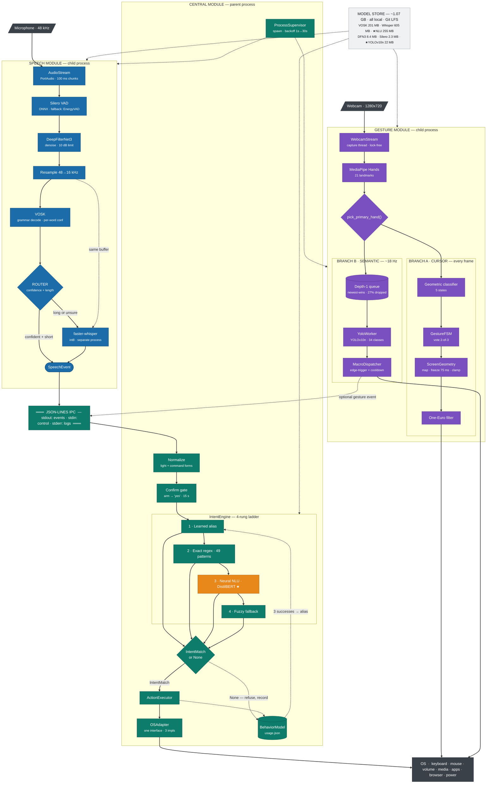
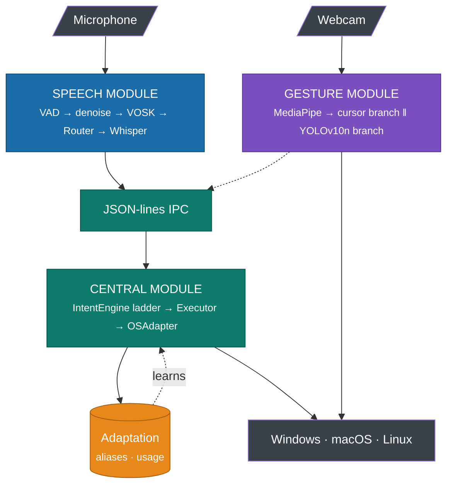

# Architecture Diagram — Generation Spec
## Context Pack for an Image / Diagram Generation Model

**System:** Context-Aware AI Multimodal Device Control System
**Source:** `github.com/CHANDU976/AI_Multimodal_Device_Control_System`, branch `vv2`
**Generated:** 24 Aug 2026

---

## READ THIS FIRST — pick the right tool

| You want | Use | Why |
|---|---|---|
| A **correct, labelled** architecture diagram for the review deck | **§7 Mermaid** or **§8 Graphviz DOT** | Text renders exactly. This is what belongs on the slide. |
| A **stylised hero image** / cover art / section divider | **§6 image prompts** | Diffusion models render text as garbage — treat labels as decoration only |
| A diagram you will hand-edit afterwards | **§8 DOT** → import to draw.io / Excalidraw | Keeps geometry, lets you nudge |

**Blunt warning for the image-model path:** every current diffusion model
(DALL·E 3, Midjourney, Imagen, SD3, Flux) fails on diagrams with more than
about 8–10 short text labels. It will invent plausible-looking nonsense
words, duplicate boxes, and drop arrows. This system has **60+ labelled
nodes**. Do not send §2 to an image model and expect a usable slide.

The realistic split:
- **§6** gives you prompts for a *simplified, 9-label* version an image
  model can actually render, plus a text-free stylised variant.
- **§7/§8** give you the real thing.

Everything in §1–§5 is tool-agnostic — it is the content any of them needs.

---

# §1 — What the diagram must communicate

Five claims, in priority order. If a viewer takes away only these, the
diagram worked:

1. **Three modules, three processes.** Speech and Gesture are *child
   processes*; Central is the *parent* that supervises them. This is a
   process boundary, not just a code boundary — draw it as one.
2. **Two independent input modalities** converge on **one** decision
   layer and **one** action layer.
3. **The speech path branches on confidence** — a fast command path and
   an escalated accuracy path, decided per utterance by the Router.
4. **The gesture path forks into two concurrent branches** at different
   rates that share nothing — cursor (every frame) and semantic
   (~18 Hz, own thread, depth-1 queue).
5. **Everything is local.** No cloud, no network. Worth an explicit
   badge or annotation.

**Anti-goals** — do not let the diagram imply:
- That speech and gesture currently fuse (they do not yet — they
  arbitrate independently under one supervisor).
- That Whisper runs on every utterance (it runs only on escalation).
- That YOLO drives the cursor (the geometric classifier does).

---

# §2 — Complete node inventory

Every box, with its exact label, sub-label, and grouping.
`ID` is for wiring in §3.

## Layer 0 — Input (top of diagram)

| ID | Label | Sub-label | Shape |
|---|---|---|---|
| `IN1` | Microphone | 48 kHz · mono · int16 | Hardware / trapezoid |
| `IN2` | Webcam | 1280×720 · 60 fps req. | Hardware / trapezoid |

## Layer 1 — Speech Module *(container: "SPEECH MODULE — child process")*

| ID | Label | Sub-label | Notes |
|---|---|---|---|
| `S1` | AudioStream | PortAudio callback · 100 ms chunks | Tees to two consumers |
| `S2` | Silero VAD | ONNX · ~2 MB · sub-ms/frame | Primary |
| `S2b` | EnergyVAD | adaptive noise floor | **Fallback** — dashed box beside `S2` |
| `S3` | DeepFilterNet3 | denoise @ 48 kHz · 10 dB limit | Operates on whole segments |
| `S4` | Resample 48→16 kHz | soxr | Small / thin box |
| `S5` | VOSK | grammar decode · per-word conf | Command ASR |
| `S6` | **Router** | confidence + length policy | **Decision diamond** |
| `S7` | faster-whisper | CTranslate2 · int8 | **Separate process** — double border |
| `S8` | VOSK (preview) | live partials only · finals discarded | Dashed, side branch |
| `S9` | SpeechEvent | command \| dictation \| partial \| error | Output token / rounded |

## Layer 2 — Gesture Module *(container: "GESTURE MODULE — child process")*

| ID | Label | Sub-label | Notes |
|---|---|---|---|
| `G1` | WebcamStream | capture thread · lock-free publish | Own thread |
| `G2` | Preprocess | flip → resize 640×360 → BGR2RGB | Preallocated buffers |
| `G3` | MediaPipe Hands | 21 landmarks · ≤2 hands · Lite | |
| `G4` | LandmarkValidator | reject implausible skeletons | |
| `G5` | pick_primary_hand() | nearest-anchor continuity | **Fork point** |
| — | *BRANCH A · CURSOR* | *every frame · ~30 Hz* | **Sub-container label** |
| `G6` | Geometric classifier | 5 states: point/peace/grip/open/idle | |
| `G7` | GestureFSM | majority vote 2-of-3 · transitions + holds | |
| `G8` | ActionDispatcher | 8 mouse actions | |
| `G9` | State freeze | 75 ms pin on pose change | Thin box |
| `G10` | ScreenGeometry | inset box → virtual desktop · clamp | |
| `G11` | One-Euro filter | per axis · speed-adaptive cutoff | |
| — | *BRANCH B · SEMANTIC* | *~18 Hz · own thread* | **Sub-container label** |
| `G12` | Depth-1 queue | newest-wins · 27 % dropped by design | **Queue shape** — cylinder or notched |
| `G13` | YoloWorker | YOLOv10n · 34 classes · CUDA | Own thread — double border |
| `G14` | Label decoration | aliases → _inverse → _side | |
| `G15` | Semantic FSM | separate instance | |
| `G16` | MacroDispatcher | edge-trigger + cooldown · 13 chords | |

## Layer 3 — IPC *(the boundary between children and parent)*

| ID | Label | Sub-label | Shape |
|---|---|---|---|
| `IPC1` | JSON-lines IPC | stdout: events · stdin: control ops · stderr: logs | **Wide horizontal bar** spanning the diagram |

## Layer 4 — Central Module *(container: "CENTRAL MODULE — parent process")*

| ID | Label | Sub-label | Notes |
|---|---|---|---|
| `C1` | ProcessSupervisor | spawn · health · backoff 1 s→30 s | Owns both children |
| `C2` | Event queue | maxsize 500 | Queue shape |
| `C3` | Normalize | light + command forms · words→digits | |
| `C4` | Custom macros | user-defined phrase expansion | |
| `C5` | Confirm gate | arm → "yes" · 15 s expiry | **Safety — accent colour** |
| `C6` | Dictation mode | type, don't parse | |
| `C7` | **IntentEngine** | 4-rung ladder | **Container** for C7a–C7d |
| `C7a` | 1 · Learned alias | dict lookup · ~1 µs | |
| `C7b` | 2 · Exact regex | 49 patterns · typed slots | |
| `C7c` | 3 · Neural NLU | DistilBERT joint · int8 · ~15–40 ms | **Highlight — our model** |
| `C7d` | 4 · Fuzzy fallback | difflib · only if model absent | Dashed |
| `C8` | IntentMatch \| **None** | refuse, don't guess | **Decision / dual-outcome** |
| `C9` | ActionExecutor | 18 handlers | |
| `C10` | OSAdapter | one interface, three impls | |
| `C11` | BehaviorModel | usage.json · alias promotion @ 3 hits | Storage |
| `C12` | PreferenceStore | preferences.json | Storage |

## Layer 5 — OS Output (bottom)

| ID | Label | Sub-label | Shape |
|---|---|---|---|
| `OS1` | Windows | ctypes SendInput / ShellExecute | Platform box |
| `OS2` | macOS | osascript | Platform box |
| `OS3` | Linux / X11 | xdotool · pactl · xdg-open | Platform box |
| `OS4` | Direct gesture output | pynput · user32 · libXtst | Platform box, fed by gesture module only |
| `OUT` | Keyboard · Mouse · Volume · Media · Apps · Browser · Power · Brightness | | Wide terminal bar |

## Side panel — Model store (right edge, visually detached)

| ID | Label | Size |
|---|---|---|
| `M1` | VOSK ×3 (en-in, en-us, hi) | 201 MB |
| `M2` | faster-whisper (base, small) | 605 MB |
| `M3` | **Joint DistilBERT NLU** ★ ours | 255 MB |
| `M4` | DeepFilterNet3 | 8.4 MB |
| `M5` | Silero VAD | 2.3 MB |
| `M6` | **YOLOv10n gestures** ★ ours | 22 MB |
| `M7` | MediaPipe Hands (Lite) | bundled |

Caption under the panel: **"~1.07 GB · all local · Git LFS · no network at inference"**
Mark `M3` and `M6` with a star or accent colour — they are the team's own
fine-tunes, and that is the diagram's one "contribution" signal.

---

# §3 — Complete edge inventory

Format: `FROM → TO [label] {style}`

## Speech path

```
IN1  → S1                              {solid, thick}
S1   → S2    [PCM chunks]              {solid}
S1   → S8    [raw stream]              {dashed, thin}
S2   ⇢ S2b   [fallback if load fails]  {dotted, bidirectional-ish}
S2   → S3    [voiced Segment]          {solid}
S3   → S4    [enhanced 48 kHz]         {solid}
S4   → S5    [16 kHz PCM]              {solid}
S5   → S6    [VoskResult + per-word conf] {solid}
S6   → S9    [CONFIDENT + SHORT → COMMAND] {solid, GREEN, labelled}
S6   → S7    [LONG or UNSURE → escalate]   {solid, AMBER, labelled}
S4   → S7    [same buffer reused]      {dashed, thin, curved}
S7   → S9    [WhisperResult]           {solid}
S8   → S9    [partials, UI only]       {dashed, thin}
S9   → IPC1                            {solid, thick}
```

> The `S4 → S7` dashed edge is worth drawing: it shows Whisper reuses the
> *same* denoised buffer VOSK saw, so escalation costs one inference and
> zero extra preprocessing.

## Gesture path

```
IN2  → G1                              {solid, thick}
G1   → G2    [newest frame only]       {solid}
G2   → G3                              {solid}
G3   → G4    [21 landmarks]            {solid}
G4   → G5                              {solid}
G5   → G6    [BRANCH A]                {solid, thick, BLUE}
G6   → G7 → G8                         {solid}
G8   → G9 → G10 → G11                  {solid}
G11  → OS4   [cursor.move(x,y)]        {solid, thick}
G5   → G12   [BRANCH B · bgr_buf.copy()] {solid, thick, PURPLE}
G12  → G13   [newest-wins]             {solid}
G13  → G14 → G15 → G16                 {solid}
G16  → OS4   [keyboard chord]          {solid}
G16  → IPC1  [optional gesture event]  {dashed, labelled "optional"}
```

## IPC and Central

```
IPC1 → C2                              {solid, thick}
C1   ⇄ S1    [spawn / supervise / shutdown] {dashed, BIDIRECTIONAL, grey}
C1   ⇄ G1    [spawn / supervise / shutdown] {dashed, BIDIRECTIONAL, grey}
C2   → C3 → C4 → C5 → C6 → C7          {solid, single spine}
C7   → C7a → C7b → C7c → C7d           {solid, vertical ladder inside C7}
C7a  → C8    [hit]                     {solid, short-circuit, GREEN}
C7b  → C8    [hit]                     {solid, short-circuit, GREEN}
C7c  → C8    [hit]                     {solid, short-circuit, GREEN}
C7d  → C8    [hit]                     {solid, short-circuit, GREEN}
C8   → C9    [IntentMatch]             {solid}
C8   → C11   [None → record as unknown] {dashed, RED/GREY, labelled "refuse"}
C9   → C10                             {solid}
C10  → OS1 / OS2 / OS3                 {solid, fan-out}
OS1/OS2/OS3 → OUT                      {solid}
OS4  → OUT                             {solid}
C9   → C11   [outcome recorded]        {dashed, feedback}
C11  ⇢ C7a   [alias promotion @ 3 hits] {dashed, CURVED FEEDBACK, accent}
C12  → C4    [macros, app aliases]     {dashed}
```

> **The single most important edge to draw well** is
> `C11 ⇢ C7a` — the adaptation feedback loop. It should be a visibly
> curved arrow looping back up the ladder, in the accent colour, labelled
> **"learns: 3 successes → alias"**. It is the only cycle in the diagram
> and it is what makes the system "context-aware".

## Model store

```
M1 ⇢ S5 , M2 ⇢ S7 , M3 ⇢ C7c , M4 ⇢ S3 , M5 ⇢ S2 , M6 ⇢ G13 , M7 ⇢ G3
{all: dotted, very light grey, no arrowheads — these are "loads from", not data flow}
```

Keep these deliberately faint. They are provenance, not pipeline.

---

# §4 — Layout geometry

**Canvas:** 16:9, landscape, 1920×1080 target.

```
┌────────────────────────────────────────────────────────────┬─────────┐
│  ROW 0   [ Microphone ]              [ Webcam ]            │ MODEL   │
├────────────────────────────────────────────────────────────┤ STORE   │
│  ROW 1   ┌─ SPEECH MODULE ─┐   ┌─ GESTURE MODULE ────────┐ │ (right  │
│          │  vertical chain │   │  chain → FORK →         │ │  rail,  │
│          │  with a BRANCH  │   │  two parallel columns   │ │  faint) │
│          │  at the Router  │   │  A: cursor  B: semantic │ │         │
│          └─────────────────┘   └─────────────────────────┘ │  ~1.07  │
├────────────────────────────────────────────────────────────┤   GB    │
│  ROW 2   ═══ JSON-LINES IPC ═══ (full-width bar) ═════════ │  local  │
├────────────────────────────────────────────────────────────┤         │
│  ROW 3   ┌─ CENTRAL MODULE ──────────────────────────────┐ │         │
│          │  spine down the middle, IntentEngine ladder   │ │         │
│          │  as a 4-rung inset, storage on the right,     │ │         │
│          │  feedback arrow curving back up               │ │         │
│          └───────────────────────────────────────────────┘ │         │
├────────────────────────────────────────────────────────────┤         │
│  ROW 4   [ Windows ] [ macOS ] [ Linux/X11 ]  [ gesture ]  │         │
│  ROW 5   ══════ OS: keyboard · mouse · volume · … ════════ │         │
└────────────────────────────────────────────────────────────┴─────────┘
```

**Proportions**
- Row 0: 6 % height · Row 1: 44 % · Row 2: 6 % · Row 3: 30 % · Rows 4–5: 14 %
- Main canvas 84 % width · model rail 16 %
- Speech container ~40 % of main width, Gesture ~60 % (it forks, it needs room)

**Flow direction:** strictly **top → bottom**. The only upward arrow in
the entire diagram is the adaptation feedback loop, which is exactly why
it reads as significant.

**Alignment rules**
- Both module containers start at the same Y so the parallel modalities
  are visually parallel.
- The IPC bar is the full width of the main canvas — it is the seam
  between process spaces, and spanning it makes that legible.
- The two gesture branches are equal-width columns; branch A is left
  (it is the latency-critical one and reads first).

---

# §5 — Visual style

## Palette

| Role | Hex | Used for |
|---|---|---|
| Speech module | `#1B6CA8` deep blue | S-node fills / container tint |
| Gesture module | `#7A4FBF` violet | G-node fills / container tint |
| Central module | `#0E7C6B` teal | C-node fills / container tint |
| Accent — ours / learned | `#E8871A` orange | `C7c`, `M3`, `M6`, feedback loop |
| Success / fast path | `#2E8B57` green | Router→command, ladder hits |
| Escalation / caution | `#C77700` amber | Router→Whisper, confirm gate |
| Refusal | `#8A8F98` grey | `C8 → C11` "None" edge |
| Hardware / OS | `#3A4149` slate | IN\*, OS\*, OUT |
| Canvas | `#FFFFFF` / `#F7F8FA` | background |
| Text | `#1A1D21` on light fills, `#FFFFFF` on saturated | |

Orange is the PES accent — reserve it strictly for **the two models the
team trained** and **the learning loop**. If everything is orange, the
contribution stops being visible.

## Shapes

| Meaning | Shape |
|---|---|
| Processing stage | Rounded rectangle, 8 px radius |
| Decision / branch | Diamond, or rounded rect with a bold left edge |
| Queue / buffer | Rectangle with a notched or stacked left edge |
| Separate process / thread | **Double border** (`S7`, `G13`, and both module containers) |
| Storage | Cylinder |
| Hardware | Trapezoid |
| Fallback / optional | **Dashed** border |
| Model file | Small tag / label chip, faint |

## Typography

- Node label: 15–16 px semibold
- Sub-label: 11–12 px regular, 70 % opacity, directly under the label
- Container title: 18 px bold, uppercase, letter-spaced, top-left of the container
- Edge label: 11 px, on a small white pill so it stays readable over lines
- One family throughout — Inter, Roboto, or Source Sans Pro

## Lines

- Data flow: 2 px solid, arrowhead at target
- Control / supervision: 1.5 px dashed, arrowheads **both ends**
- Model load: 1 px dotted, no arrowhead, 40 % opacity
- Feedback: 2 px dashed, curved, accent colour, arrowhead at target
- Prefer orthogonal routing with rounded corners; keep crossings out of
  the two module containers

## Required annotations

Place these as small callout chips, not body text:

1. **"100 % offline — no cloud, no network"** — near the model rail
2. **"27 % of frames dropped by design"** — on the `G12` queue
3. **"refuses instead of guessing"** — on the `C8 → C11` edge
4. **"learns: 3 successes → alias"** — on the feedback loop
5. **"~18 Hz · never blocks the cursor"** — on branch B
6. **"one interface · three OS implementations"** — on `C10`

---

# §6 — Prompts for an image-generation model

## 6a. Simplified system diagram — 9 labels max *(the only text-bearing prompt with a real chance)*

> A clean, professional software architecture diagram on a white
> background, 16:9 landscape, flat vector infographic style, thin
> rounded rectangles with subtle drop shadows, orthogonal connector
> lines with small arrowheads, generous whitespace.
>
> Top row: two small trapezoid hardware icons — a microphone on the
> left, a webcam on the right.
>
> Middle row: two large rounded container panels side by side. The left
> panel is tinted deep blue and contains a vertical chain of four
> rounded boxes ending in a diamond that splits into two short paths.
> The right panel is tinted violet and contains a chain of three boxes
> that forks into two parallel vertical columns.
>
> A single full-width horizontal teal bar spans beneath both panels.
>
> Bottom row: one wide teal container panel with a vertical spine of
> five boxes down its centre, a small four-rung ladder inset on its
> right side, and one orange curved arrow looping from the bottom of
> the panel back up to the top of the ladder.
>
> Very bottom: three small slate-grey platform chips in a row, above a
> single wide dark bar.
>
> Colour palette: deep blue #1B6CA8, violet #7A4FBF, teal #0E7C6B,
> orange accent #E8871A, slate #3A4149, white background. Minimal,
> corporate, technical-documentation aesthetic. Crisp thin lines. No
> gradients, no 3D, no isometric perspective, no photorealism.

**Then add labels yourself** in PowerPoint / Figma. This is the workflow
that actually produces a usable image: generate the *structure*, place
the *text* by hand.

## 6b. Text-free hero / cover image *(safest image-model use)*

> An abstract technical illustration representing a multimodal AI
> system, 16:9, flat vector style on a white background. Two streams of
> flowing particles enter from the top left and top right — the left
> stream rendered as deep blue concentric sound waves, the right as a
> violet constellation of connected dots forming a hand-skeleton
> silhouette. Both streams converge into a single horizontal teal band
> across the middle of the frame, then descend as one unified beam into
> a network of small interconnected nodes at the bottom. One thin orange
> line curves upward from the node network back toward the teal band,
> forming a closed loop. Minimal, elegant, corporate technical
> aesthetic. Deep blue #1B6CA8, violet #7A4FBF, teal #0E7C6B, orange
> #E8871A on white. No text, no letters, no words, no numbers, no
> typography of any kind. Clean vector shapes, thin consistent line
> weights, generous negative space.

The "no text, no letters, no words" clause is doing real work — say it
explicitly or the model will scatter fake labels everywhere.

## 6c. Per-module illustration *(one modality at a time — better odds)*

> A flat vector technical diagram of a speech-processing pipeline, 16:9,
> white background. A single vertical chain of six rounded rectangles
> connected by thin downward arrows. The fourth shape in the chain is a
> diamond, from which two arrows diverge — one short green arrow going
> straight down, one longer amber arrow curving out to the right and
> into a rectangle with a double border, which then rejoins the main
> path below. Deep blue #1B6CA8 fills, white text areas left blank,
> minimal corporate documentation style, thin crisp lines, no gradients.

Swap the geometry description for the gesture fork or the central ladder
to get the other two.

## 6d. Negative prompt *(append to any of the above)*

> cluttered, busy, overlapping shapes, unreadable text, gibberish
> lettering, garbled words, random characters, watermark, signature,
> 3D render, isometric, drop shadow heavy, neon, glow, dark background,
> photorealistic, hand-drawn sketch, whiteboard, stock-photo people,
> circuit board, robot, brain illustration, glowing blue AI hologram

---

# §7 — Mermaid source *(renders correctly — use this for the slide)*



> **Note:** Mermaid renders natively inside Claude Artifacts, GitHub,
> Notion, Obsidian, and mermaid.live. For PowerPoint, render at
> mermaid.live and export SVG → paste as a vector shape so it stays
> crisp when projected.

---

# §8 — Graphviz DOT source *(finest layout control; best for print)*

```dot
digraph architecture {
    rankdir=TB;
    bgcolor="white";
    splines=ortho;
    nodesep=0.35;
    ranksep=0.55;
    fontname="Inter";
    node [shape=box style="rounded,filled" fontname="Inter" fontsize=11
          margin="0.18,0.10" penwidth=1.2];
    edge [fontname="Inter" fontsize=9 penwidth=1.4 color="#3A4149"];

    // ── Input ──────────────────────────────────────────────
    IN1 [label="Microphone\n48 kHz" shape=invtrapezium fillcolor="#3A4149" fontcolor=white];
    IN2 [label="Webcam\n1280x720"  shape=invtrapezium fillcolor="#3A4149" fontcolor=white];

    // ── Speech ─────────────────────────────────────────────
    subgraph cluster_speech {
        label="SPEECH MODULE  —  child process";
        fontsize=13; fontcolor="#0F4A75"; color="#1B6CA8";
        style="rounded"; penwidth=2;
        node [fillcolor="#1B6CA8" fontcolor=white];

        S1 [label="AudioStream\nPortAudio · 100 ms"];
        S2 [label="Silero VAD\nONNX · ~2 MB"];
        S2b[label="EnergyVAD\nfallback" style="rounded,filled,dashed"];
        S3 [label="DeepFilterNet3\ndenoise · 10 dB limit"];
        S4 [label="Resample 48→16 kHz"];
        S5 [label="VOSK\ngrammar · per-word conf"];
        S6 [label="ROUTER" shape=diamond fillcolor="#12507C"];
        S7 [label="faster-whisper\nint8 · own process" peripheries=2];
        S9 [label="SpeechEvent" shape=box style="rounded,filled"];

        S1->S2; S2->S3; S3->S4; S4->S5; S5->S6;
        S2->S2b [style=dotted dir=both label="fallback"];
        S6->S9 [label="confident\n+ short" color="#2E8B57" penwidth=2];
        S6->S7 [label="long or\nunsure"   color="#C77700" penwidth=2];
        S4->S7 [style=dashed constraint=false label="same buffer"];
        S7->S9;
    }

    // ── Gesture ────────────────────────────────────────────
    subgraph cluster_gesture {
        label="GESTURE MODULE  —  child process";
        fontsize=13; fontcolor="#553091"; color="#7A4FBF";
        style="rounded"; penwidth=2;
        node [fillcolor="#7A4FBF" fontcolor=white];

        G1 [label="WebcamStream\ncapture thread"];
        G3 [label="MediaPipe Hands\n21 landmarks"];
        G5 [label="pick_primary_hand()" shape=diamond fillcolor="#61399B"];

        subgraph cluster_ba {
            label="BRANCH A · CURSOR  —  every frame";
            fontsize=10; color="#9B7BD4"; style="rounded,dashed";
            G6 [label="Geometric classifier\n5 states"];
            G7 [label="GestureFSM\nvote 2-of-3"];
            G10[label="ScreenGeometry\nmap · freeze · clamp"];
            G11[label="One-Euro filter"];
            G6->G7->G10->G11;
        }
        subgraph cluster_bb {
            label="BRANCH B · SEMANTIC  —  ~18 Hz";
            fontsize=10; color="#9B7BD4"; style="rounded,dashed";
            G12[label="Depth-1 queue\nnewest-wins · 27% dropped" shape=cylinder];
            G13[label="YoloWorker\nYOLOv10n · 34 classes" peripheries=2];
            G16[label="MacroDispatcher\nedge-trigger + cooldown"];
            G12->G13->G16;
        }
        G1->G3->G5;
        G5->G6  [penwidth=2.4];
        G5->G12 [penwidth=2.4];
    }

    // ── IPC ────────────────────────────────────────────────
    IPC [label="JSON-LINES IPC   ·   stdout: events   ·   stdin: control ops   ·   stderr: logs"
         shape=box style="filled" fillcolor="#0E7C6B" fontcolor=white
         width=9 height=0.45 fontsize=11];

    // ── Central ────────────────────────────────────────────
    subgraph cluster_central {
        label="CENTRAL MODULE  —  parent process";
        fontsize=13; fontcolor="#095449"; color="#0E7C6B";
        style="rounded"; penwidth=2;
        node [fillcolor="#0E7C6B" fontcolor=white];

        C1 [label="ProcessSupervisor\nbackoff 1s→30s · 5 tries"];
        C3 [label="Normalize\nlight + command forms"];
        C5 [label="Confirm gate\narm → 'yes' · 15 s" fillcolor="#C77700"];

        subgraph cluster_ladder {
            label="IntentEngine — 4-rung ladder";
            fontsize=10; color="#5BAFA2"; style="rounded,dashed";
            C7a[label="1 · Learned alias\n~1 us"];
            C7b[label="2 · Exact regex\n49 patterns"];
            C7c[label="3 · Neural NLU\nDistilBERT · int8" fillcolor="#E8871A"];
            C7d[label="4 · Fuzzy fallback" style="rounded,filled,dashed"];
            C7a->C7b->C7c->C7d;
        }

        C8 [label="IntentMatch\nor None" shape=diamond fillcolor="#0A6355"];
        C9 [label="ActionExecutor\n18 handlers"];
        C10[label="OSAdapter\none interface · 3 impls"];
        C11[label="BehaviorModel\nusage.json" shape=cylinder];

        C3->C5->C7a;
        C7a->C8 [color="#2E8B57"];
        C7b->C8 [color="#2E8B57"];
        C7c->C8 [color="#2E8B57"];
        C7d->C8 [color="#2E8B57"];
        C8->C9  [label="IntentMatch"];
        C8->C11 [label="None — refuse" style=dashed color="#8A8F98"];
        C9->C10;
        C9->C11 [style=dashed];
        C11->C7a [label="3 successes\n→ alias" style=dashed
                  color="#E8871A" penwidth=2 constraint=false];
    }

    // ── Output ─────────────────────────────────────────────
    OS  [label="Windows  |  macOS  |  Linux / X11" shape=record
         fillcolor="#3A4149" fontcolor=white];
    OUT [label="keyboard · mouse · volume · media · apps · browser · power · brightness"
         shape=box fillcolor="#20252B" fontcolor=white width=9 height=0.4];

    // ── Model store ────────────────────────────────────────
    MODELS [label="MODEL STORE  ~1.07 GB\nall local · Git LFS · no network\l
VOSK 201 MB\lfaster-whisper 605 MB\l★ Joint DistilBERT 255 MB\l
DeepFilterNet3 8.4 MB\lSilero VAD 2.3 MB\l★ YOLOv10n 22 MB\l"
            shape=note fillcolor="#F0F1F3" fontcolor="#1A1D21" fontsize=9];

    // ── Cross-layer wiring ─────────────────────────────────
    IN1->S1 [penwidth=2.4];
    IN2->G1 [penwidth=2.4];
    S9->IPC [penwidth=2.4];
    G16->IPC [style=dashed label="optional"];
    IPC->C3 [penwidth=2.4];
    C1->S1  [style=dashed dir=both color="#8A8F98" label="supervise"];
    C1->G1  [style=dashed dir=both color="#8A8F98" label="supervise"];
    C10->OS; OS->OUT;
    G11->OUT [label="cursor.move()"];
    G16->OUT [label="key chord"];
    MODELS->S5  [style=dotted arrowhead=none color="#C4C8CE"];
    MODELS->G13 [style=dotted arrowhead=none color="#C4C8CE"];
    MODELS->C7c [style=dotted arrowhead=none color="#C4C8CE"];

    { rank=same; IN1; IN2; }
    { rank=same; OS; MODELS; }
}
```



**Render:**
```bash
dot -Tsvg ARCHITECTURE.dot -o architecture.svg    # vector — use for slides
dot -Tpng -Gdpi=300 ARCHITECTURE.dot -o architecture.png
```
Or paste into `dreampuf.github.io/GraphvizOnline`.

---

# §9 — Simplified variant *(if the full diagram is too dense for one slide)*

The template allows two architecture slides. Recommended split:

**Slide A — system overview** (this reduced graph):



**Slide B — pipeline detail**: the full §7 diagram, or two half-width
panels (speech pipeline left, gesture dual-branch right).

---

# §10 — Checklist before you ship the diagram

- [ ] Three process boundaries visually distinct (two children, one parent)
- [ ] Router branch labelled on **both** outgoing edges
- [ ] Gesture fork shows **two** columns, with rates on each
- [ ] The `None` / refusal edge is present and labelled
- [ ] The adaptation feedback loop is the only upward arrow, in accent colour
- [ ] `★` on exactly two models (DistilBERT NLU, YOLOv10n) — the team's own
- [ ] "100 % offline" stated somewhere
- [ ] Three OS targets shown
- [ ] Legend present if you used dashed = fallback and dotted = model load
- [ ] Readable at **50 % zoom** — that is roughly what a projector gives you
- [ ] Exported as **SVG**, not PNG, if it is going into PowerPoint
