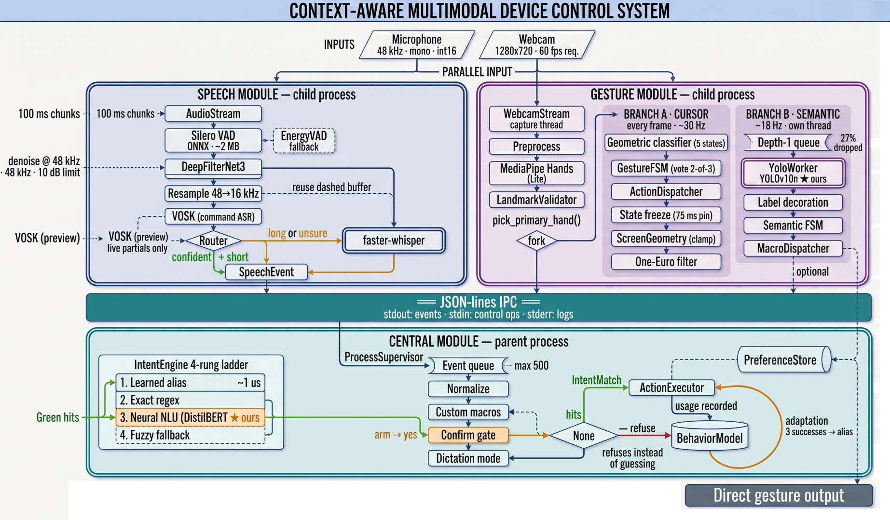

# AI Multimodal Device Control System

## 📋 Project Overview

A Laptop/Desktop Control System Which used Speech, Hand gestures and User Context and preferences wisely Using AI Technilogies

Conventional desktop interaction still assumes a keyboard and a mouse in hand. This project
replaces that assumption with a **fully offline, context-aware multimodal control layer** for
Windows, macOS and Linux. A microphone and a commodity webcam become the input devices: speech
is segmented, denoised, transcribed and parsed into typed intents; hand poses are tracked and
classified into cursor motion and bound actions; and a central orchestrator executes both
through one OS-independent action interface while learning the user's phrasing over time.

Every model — VAD, denoiser, two speech recognisers, a joint intent+slot transformer and a
fine-tuned gesture detector — runs locally on CPU/GPU with **no network dependency and no cloud
API**, so the system is usable offline and leaks no audio or video.

**7** local models, 0 cloud calls · **2** models fine-tuned by us · **49** voice intents +
refusal · **3** operating systems

*Team #24 · UE23CS441A Capstone Project Phase 3 · Project Guide: **Dr. Ashwini K***

## 👥 Team Members

- **Chandan B L** (PES2UG23AM021) - Central orchestration + NLU: supervisor, IPC, manager, intent ladder, DistilBERT joint model, dataset generator, training, adaptation - [GitHub: @CHANDU976]
- **Banger Atif Ahmed** (PES2UG23AM019) - Gesture module (base implementation): tracking engine, dual-branch architecture, screen mapping, FSM, GUI, diagnostics, bench harness
- **Sampada S Shetty** (PES2UG23CS522) - Real-time engine + audio, dictation + intelligence: AudioStream, Silero / Energy VAD, DFN3 denoiser, VOSK engine, device hot-swap, resampling, Whisper worker process, confidence router, command/dictation classifier, calibration harness
- **Nikhil Sai K** (PES2UG23CS279) - Gesture module (OS adaptation): OS adapters for mouse control through gestures

## 🎯 Project Goals

Develop a **touchless, multimodal and context-aware control system** using speech recognition
and gesture recognition, ensuring:

- **Offline processing** - every inference is local; no cloud ASR, no LLM API
- **Low latency** - real-time cursor control and sub-second command execution
- **High accuracy** - fine-tuned models with calibrated, measured thresholds
- **Platform portability** - Windows, macOS and Linux from one codebase

## ✨ Features

- **Offline speech pipeline**: VAD → denoise → dual-ASR → per-utterance confidence routing, with
  no spoken mode switch to remember
- **Neural NLU**: 49 intents + typed slots + an explicitly trained refusal class — the system
  refuses rather than guesses
- **Vision-based cursor control**: MediaPipe hand tracking with a bindable gesture→action engine;
  adding a gesture is a config change, never a code change
- **Central orchestrator**: process supervision, JSON-lines IPC, execution and arbitration across
  both modalities
- **OS-independent action layer**: keyboard, mouse, volume, media, apps and browser on
  Windows / macOS / Linux-X11
- **Personalisation**: alias promotion, usage learning and user-defined macros
- **Multilingual ASR**: Indian English, US English and Hindi with a runtime language switch
- **Safety**: `shutdown` / `restart` arm and wait for a spoken "yes", expiring after 15 s

## 🏗️ System Architecture

Five layers. The speech and gesture modules run as **child processes** and speak JSON-lines to
the central parent over stdout / stdin (stderr carries logs).

<p align="center">
  
</p>

<p align="center"><em>Full pipeline: parallel speech and gesture child processes feeding the central orchestrator over JSON-lines IPC, then the OS action layer.</em></p>

Three design points worth calling out:

- **The router is the novelty** — the escalation decision reuses evidence VOSK has *already*
  produced (per-word confidence + `[unk]` ratio), so accuracy costs nothing on the fast path and
  the user never has to remember a mode.
- **The dual-branch gesture design** — cursor motion and classification run at different rates and
  share nothing, so 55 ms inference never stalls a 30 Hz cursor.
- **The `None` return** — the intent engine is allowed to say "I don't know". That is a feature,
  not a gap.

### Components

- **Speech module** (`speech_module/`, 13 files · 3,748 lines): mic capture, Silero VAD,
  DeepFilterNet3 denoising (capped at 10 dB attenuation), VOSK command ASR with per-word
  confidence, the confidence router, and a faster-whisper int8 dictation worker in a separate
  process so model inference never blocks the real-time loop.
- **Central module** (`central_module/`, 26 files · 3,909 lines): process supervisor, JSON-lines
  IPC, text normalisation, the 4-rung intent ladder (learned alias → exact regex → DistilBERT
  joint NLU → fuzzy fallback), the action executor, three OS adapters, and the adaptation layer
  that promotes repeated fuzzy matches to aliases.
- **Gesture module** (`Mousegesture/`, 6 active files · 11,098 lines): MediaPipe hand tracking
  split into a deterministic geometric cursor branch and a fine-tuned YOLOv10n semantic branch,
  a config-driven FSM with five false-trigger guards, a binding GUI, and an instrumented bench.

### Data contracts per module

| Module              | Input                       | Output                                                  | Interface                    |
| ------------------- | --------------------------- | ------------------------------------------------------- | ---------------------------- |
| `AudioStream`     | PortAudio callback          | int16 PCM, 48 kHz, 4800-frame chunks (100 ms)           | in-process queue             |
| `VAD`             | PCM chunks                  | `Segment(pcm, duration_s, peak_rms, speech_prob…)`   | queue, depth 8               |
| `Denoiser` (DFN3) | Voiced segment @ 48 kHz     | Enhanced segment, ≤10 dB attenuation limit             | in-process                   |
| `VOSK`            | 16 kHz PCM                  | `VoskResult(text, words[], mean/min conf, unk_ratio)` | in-process                   |
| `Router`          | `VoskResult`              | `Decision(destination, reason, text)`                 | pure policy object           |
| `Whisper`         | Same 16 kHz buffer VOSK saw | `WhisperResult(text, language, segments)`             | separate process             |
| `speech_runner`   | `SpeechEvent`             | `{"type":"command"\|"dictation"\|"partial"}`            | stdout pipe                  |
| Central IPC         | JSON lines                  | `{"op":"set_language"\|"get_devices"\|"ping"}`          | stdin pipe                   |
| `IntentEngine`    | Normalized utterance        | `IntentMatch(intent, slots, confidence)` or `None`  | in-process                   |
| `ActionExecutor`  | `IntentMatch`             | `ActionResult(ok, message, needs_confirm)`            | in-process                   |
| `OSAdapter`       | Primitive call              | OS event, or`ActionError` with a readable reason      | ctypes / osascript / xdotool |
| Gesture engine      | Camera frame                | Cursor position + fired action; optional gesture event  | stdout pipe                  |

## 🛠️ Technologies Used

- **Programming Languages**: Python 3.11 (3.8–3.11 only — see the Installation note)
- **AI/ML Frameworks**: PyTorch 2.13.0+cpu, torchaudio 2.11.0, transformers 4.46.3, Ultralytics 8.3, onnxruntime, CUDA 12.1
- **Multimodal Processing**:
  - *Speech* — vosk 0.3.45, faster-whisper 1.2.1 (CTranslate2), deepfilternet 0.5.6
  - *Audio I/O* — sounddevice 0.5.5 (PortAudio), soxr 1.1.0, soundfile 0.14.0, librosa 0.11.0
  - *Vision* — OpenCV 4.11, MediaPipe 0.10 (`model_complexity=0`)
- **Hardware Integration**: commodity webcam + microphone only. No depth camera, wearable or
  non-standard hardware. I/O control via pynput and ctypes → `user32.dll` / `shcore` on Windows,
  `osascript` on macOS, libX11 / libXtst / libXinerama on Linux-X11.
- **Other Tools**: Tkinter + ttk and Pillow for the GUI; psutil and nvidia-ml-py (pynvml) for
  telemetry; threading / multiprocessing (`spawn`) / queue / subprocess for concurrency;
  Git and **Git LFS** for models (`*.pt`, `*.onnx`).

### Models — all local, ~1.07 GB total, versioned with Git LFS

| Model                          | Purpose                        | Size             | Licence          |
| ------------------------------ | ------------------------------ | ---------------- | ---------------- |
| VOSK small en-in / en-us / hi  | Command ASR, 3 languages       | 201 MB           | Apache 2.0       |
| faster-whisper base + small    | Dictation ASR                  | 605 MB           | MIT              |
| DeepFilterNet3                 | Speech enhancement             | 8.4 MB           | MIT / Apache 2.0 |
| Silero VAD                     | Neural speech detection        | 2.3 MB           | MIT              |
| **Joint DistilBERT NLU** | **Intent + slot (ours)** | **255 MB** | Apache 2.0 base  |
| **YOLOv10n gestures**    | **34-class pose (ours)** | **22 MB**  | AGPL-3.0         |
| MediaPipe Hands (Lite)         | 21 hand landmarks              | bundled          | Apache 2.0       |

Two of the seven models are our own fine-tunes. The joint NLU model is a `distilbert-base-uncased`
backbone (66 M params) with an intent head and a BIO slot head, trained on 35,853 synthetic
examples over 50 classes (49 intents + `none`) and 13 slot labels, reaching **98.88 % intent /
99.70 % slot accuracy** on the dev set and shipped as a dynamic-int8 artefact.

## 📦 Installation

### ⚠️ Python 3.8 – 3.11 only

**Not 3.12 or 3.13.** DeepFilterNet's native library (`DeepFilterLib`) publishes
wheels for `cp38`–`cp311` only, and DeepFilterNet pins `numpy<2`, which the whole
stack has to respect. On a newer interpreter the denoiser silently degrades to
pass-through — set `DENOISE["required"] = True` in `speech_module/config.py` to
turn that into a startup error instead.

`python3.11` is what you want, even if a newer Python is your system default.

### Platform support

|                     | Windows x64    | Linux x86_64            | macOS Apple Silicon | macOS Intel   |
| ------------------- | -------------- | ----------------------- | ------------------- | ------------- |
| DeepFilterNet3      | ✅             | ✅                      | ✅                  | ✅            |
| VOSK                | `0.3.45`     | `0.3.45`              | `0.3.44` ¹       | `0.3.44` ¹ |
| torch / torchaudio  | `2.13.0+cpu` | `2.13.0+cpu`          | `2.13.0` ²       | `2.2.2` ³  |
| PortAudio (mic)     | bundled        | **install it** ⁴ | bundled             | bundled       |
| Gesture module      | ✅             | X11 only                | —                  | —            |
| Verified end-to-end | ✅             | —                      | —                  | —            |

- ¹ vosk `0.3.45` shipped no macOS wheel; `0.3.44` is `universal2` and covers both Macs.
- ² PyTorch publishes no `+cpu` variant for macOS — the PyPI wheels are already native. The `2.13.0` wheel is built for macOS 14+; on macOS 13 or older, pin `torch==2.2.2` / `torchaudio==2.2.2` instead.
- ³ PyTorch **stopped building macOS x86_64 wheels after 2.2.2**. Intel Macs are capped there. Everything else in the stack still works.
- ⁴ `sounddevice` bundles PortAudio on Windows and macOS but not on Linux.

`requirements.txt` encodes all of this with environment markers, so the same
file installs the right thing on every platform.

---

### 1. Git LFS — before cloning

The VOSK, Whisper and NLU models are LFS objects. Clone without LFS and you get
text pointer files, and every model load fails.

```bash
# Windows  : winget install GitHub.GitLFS      (or: choco install git-lfs)
# Debian   : sudo apt install git-lfs
# Fedora   : sudo dnf install git-lfs
# macOS    : brew install git-lfs

git lfs install
git clone https://github.com/CHANDU976/AI_Multimodal_Device_Control_System.git
cd AI_Multimodal_Device_Control_System
```

Already cloned without it? `git lfs install && git lfs pull`.

### 2. System audio library

Only Linux needs anything here:

```bash
# Debian / Ubuntu
sudo apt install libportaudio2 python3.11-venv

# Fedora
sudo dnf install portaudio

# Windows / macOS — nothing to do, the sounddevice wheel bundles PortAudio.
# (macOS: `brew install portaudio` only if sounddevice fails to find a device.)
```

### 3. Virtual environment + dependencies

**Windows** (PowerShell):

```powershell
py -3.11 -m venv .venv
.venv\Scripts\python.exe -m pip install -r requirements.txt
```

**Linux / macOS** (Apple Silicon and Intel alike):

```bash
python3.11 -m venv .venv
.venv/bin/python -m pip install -r requirements.txt
```

Always invoke the venv interpreter explicitly (`.venv\Scripts\python.exe` /
`.venv/bin/python`) rather than a bare `python`, or you will silently hit the
system 3.13 and lose the denoiser.

### 4. Speech models

VOSK, Whisper and the NLU model arrive with the clone via LFS. DeepFilterNet3 (~8 MB) is
fetched separately — it is not in the repo:

```bash
.venv/bin/python fetch_deepfilternet_model.py        # Windows: .venv\Scripts\python.exe
```

This populates `Models/DFN3/` with `config.ini` + `checkpoints/`. It depends on
nothing but the standard library, so it also runs on your system Python.

Expected layout:

```
Models/
  DFN3/        config.ini, checkpoints/model_120.ckpt.best
  VOSK/        vosk-model-small-{en-in,en-us,hi}-*
  WHISPER/     faster-whisper-{base,small}/  (model.bin, config.json,
               tokenizer.json, vocabulary.txt — CTranslate2 format)
  NLU/         joint-distilbert/  (tokenizer, config, fine-tuned weights)
```

### 5. FFmpeg — not needed

The dictation engine is faster-whisper, which never shells out to an ffmpeg
binary. `WhisperEngine.transcribe()` is handed a numpy array of already-decoded
mic PCM, and even file-path input would be decoded by PyAV, whose pip wheel
bundles the ffmpeg libraries. No system ffmpeg install is required for anything.

### 6. Verify

```bash
.venv/bin/python speech_module/denoiser.py      # loads DFN3, records 5 s, writes before/after wavs
.venv/bin/python speech_module/speech_manager.py  # full pipeline, speak into the mic
```

If `denoiser.py` logs `DFN3 loaded from …`, the denoiser is live. A
`DeepFilterNet3 unavailable: …` warning means you are on the wrong interpreter
or `Models/DFN3` is empty.

## 🚀 Usage

Run everything through the venv interpreter (`.venv\Scripts\python.exe` on Windows,
`.venv/bin/python` elsewhere).

**Full system** — mic + both child processes:

```bash
python -m central_module
python -m central_module --verbose        # debug logging + live speech partials
```

**Without hardware, or without actually executing:**

```bash
python -m central_module --simulate       # type commands instead of speaking
python -m central_module --dry-run        # report actions instead of executing them
python -m central_module --once "open chrome" --dry-run
python -m central_module --no-speech      # supervisor without the speech child
python -m central_module --gesture-stub   # run the bundled gesture stub child
```

**Speech module standalone:**

```bash
python speech_module/speech_manager.py    # full speech pipeline
python speech_module/denoiser.py          # record 5 s, write before/after WAVs
python speech_module/calibrate.py         # decode WAVs, report confidence distributions
```

**Gesture module standalone:**

```bash
cd Mousegesture
python hand_cursor_2.py                   # tracking engine + cursor control
python app.py                             # Gesture Studio — bind poses to actions (3-tab GUI)
```

`app.py` never touches the camera. Its only job is to produce `gesture_config.json`; the engine's
only job is to consume one. That split is why a whole control scheme can be redesigned without
restarting the tracker.

**Re-training the NLU model:**

```bash
python -m central_module.nlp.nlu.train          # full training, ~36 min on CPU
python -m central_module.nlp.nlu.train --quick  # short sanity run (artefact marked untrusted)
```

## 📖 Documentation

- `README.md` (this file) — install, platform matrix, verification steps
- [`Architecture_diagram/`](Architecture_diagram/) — the rendered HLD (`HLD_v7.png`) and `ARCHITECTURE_DIAGRAM_SPEC.md`, the full pipeline diagram specification
- `Mousegesture/README.md` — gesture engine and binding GUI notes
- Every module's configuration file carries **the measurement that justifies each constant**,
  in-comment — thresholds were calibrated, not guessed. Start with `speech_module/config.py`
  (`ROUTING`, `DENOISE`) and `Mousegesture/gesture_config.json`.

## 🧪 Testing

The project has runnable **smoke tests and one instrumented bench harness — not a pytest suite**.
Migrating these into `tests/` is named in Remaining Work below.

| Module  | What is tested                             | How                                                                                                                                                                                                                                                         |
| ------- | ------------------------------------------ | ----------------------------------------------------------------------------------------------------------------------------------------------------------------------------------------------------------------------------------------------------------- |
| Speech  | Every non-trivial file runs standalone     | `python speech_module/denoiser.py` records 5 s and writes before/after WAVs; `speech_manager.py` runs the full pipeline                                                                                                                                 |
| Speech  | Routing thresholds calibrated, not guessed | `calibrate.py` decodes a folder of WAVs twice — free and grammar-constrained — and reports where the confidence distributions actually sit                                                                                                              |
| Central | Every module has a`__main__` smoke test  | `python -m central_module.nlp.normalize`, `.intent_engine`, `.learning.adaptation`, `.supervisor` (spawns a deliberately flaky child), `.actions.windows_adapter`                                                                                 |
| Central | Full pipeline without hardware             | `--simulate --dry-run` types commands and reports what *would* happen; `--once "open chrome" --dry-run` runs one utterance end-to-end                                                                                                                 |
| NLU     | Pipeline sanity · dataset integrity       | `train.py --quick` (40/intent, 1 epoch) — the artefact is marked untrusted so it cannot silently degrade the live system; `dataset.py` asserts tag/word alignment and `none`-class presence                                                          |
| Gesture | FSM logic                                  | `python gesture_fsm.py` runs a scripted hand sequence including a stray frame and an unmapped intermediate pose, printing which actions fired                                                                                                             |
| Gesture | Real-pipeline instrumented bench           | `gesture_test.py` attaches a read-only probe to the running engine for 50 attempts and reports which of ~18 stages each attempt reached — YOLO detection → stabiliser → transition → rule match → cooldown → dispatch → OS click actually observed |

## 📈 Performance vs baseline

Reference hardware: RTX 3050 6 GB Laptop (driver 610.88, WDDM) · CUDA 12.1 / PyTorch 2.5.1+cu121
· Windows 11 · Python 3.11.15. `[M]` = measured on that hardware.

**Speech + NLU**

| Metric                      | Baseline                | Ours                            | Δ                                |
| --------------------------- | ----------------------- | ------------------------------- | --------------------------------- |
| VOSK WER in noise           | Raw audio               | DFN3-denoised                   | **−6 to −11 WER pts** [M] |
| Whisper WER @ 5 dB SNR      | Full DFN3 suppression   | 10 dB attenuation limit         | −3.3 pts [M]                     |
| Whisper WER @ 0 dB SNR      | Full DFN3 suppression   | 10 dB attenuation limit         | −10.1 pts [M]                    |
| NLU dev intent accuracy     | Fuzzy difflib (Phase-2) | **98.88 %**               | —                                |
| NLU dev slot accuracy       | No slot extraction      | **99.70 %**               | —                                |
| NLU inference latency (CPU) | fp32                    | int8, ~15–40 ms/parse          | 2–3× faster [M]                 |
| Intent vocabulary           | Keyword prefixes (23)   | 49 intents + refusal class      | —                                |
| Alias promotion             | —                      | 3 fuzzy hits → exact fast path | ~1 µs vs ~15 ms                  |

**Gesture**

| Metric                                | Baseline → Ours                                     | Δ                          |
| ------------------------------------- | ---------------------------------------------------- | --------------------------- |
| YOLO inference latency                | ONNX`cv2.dnn` 554.7 ms → Ultralytics + CUDA 55 ms | **10.1× faster** [M] |
| Semantic branch throughput            | 1.8 Hz → 18 Hz                                      | 10× [M]                    |
| Frames dropped by queue               | 83 % (ONNX) → 27 % (by design)                      | −56 pts [M]                |
| Gesture-induced cursor drift          | Fingertip 108 px → landmark-9 0.0 px                | eliminated [M]              |
| Click latency after pose settles      | 33 ms — one frame @ 30 Hz                           | — [M]                      |
| Orientation stability (`three_gun`) | 252 flips / 3,000 frames → 0 flips                  | eliminated [M]              |
| Start-up latency                      | 10.8 s frozen → deferred to worker, 0.1 ms          | −10.8 s [M]                |
| Multi-hand cursor jump                | `multi_hand_landmarks[0]` 499 px → 13 px          | −97 % [M]                  |

**Known limitations** — WER figures come from TTS speech plus synthetic fan and pink noise, not a
standard corpus. NLU accuracy is on a synthetic dev set from the same generator as training; a
held-out real-utterance set is remaining work. Sustained end-to-end FPS, true photon-to-cursor
latency and steady-state CPU/RAM are displayed live but not logged or asserted. Per-process VRAM
cannot be read on this hardware — WDDM makes NVML return `None` for every process.

## 🗓️ Project Timeline

**Completed (Phase-3)**

| Task                                                     | Window     |
| -------------------------------------------------------- | ---------- |
| Speech pipeline redesign — VAD / DFN3 / router          | Aug W1–W2 |
| Whisper migration to faster-whisper int8                 | Aug W1     |
| Grammar-constrained VOSK +`[unk]` routing signal       | Aug W2     |
| Intent catalog — 49 intents, typed slots, confirm flags | Aug W2     |
| Synthetic dataset generator + augmentation gauntlet      | Aug W2     |
| DistilBERT joint NLU training (~36 min CPU)              | Aug W2     |
| OS adapter layer — Windows / macOS / Linux              | Aug W2–W3 |
| Process supervisor + JSON-lines IPC                      | Aug W3     |
| Adaptation layer — alias promotion / demotion           | Aug W3     |
| Gesture module integration into the supervised system    | Aug W3     |
| Gesture bench harness (`gesture_test.py`)              | Aug W3     |

**Planned**

| Task                                                                        | Window         | Depends on           |
| --------------------------------------------------------------------------- | -------------- | -------------------- |
| Held-out evaluation harness + real-utterance set                            | Sep W1         | —                   |
| Multimodal fusion — deictic slot resolution                                | Sep W2–W3     | Gesture event stream |
| Unified settings UI                                                         | Sep W4         | Fusion contracts     |
| `tests/` migration to pytest                                              | Oct W1         | —                   |
| Cross-platform verification (Linux + macOS)                                 | Oct W1–W2     | Adapters             |
| Context awareness v2 (time / foreground app)                                | Oct W3         | `usage.json`       |
| Wake word + TTS feedback                                                    | Oct W3         | —                   |
| Repo hygiene + packaging, final integration testing, report and paper draft | after Review#2 | —                   |

## 📊 Project Status

**Done**

- [X] Offline speech pipeline: VAD → denoise → dual-ASR → confidence routing
- [X] Natural-language understanding: 49 intents + slots + explicit refusal
- [X] Vision-based cursor control + bindable gesture→action engine
- [X] Central orchestrator: process supervision, IPC, execution, arbitration
- [X] OS-independent action layer (Windows / macOS / Linux-X11)
- [X] Personalisation: alias promotion, usage learning, user macros
- [X] Multilingual ASR (Indian English, US English, Hindi), runtime switch

**Remaining**

- [ ] Unified settings UI across all three modalities *(High)* — the gesture GUI is separate; speech and central are configured through JSON files
- [ ] True multimodal fusion — speech ↔ gesture mutual disambiguation *(High)* — this is the "multimodal" claim in the title
- [ ] Held-out evaluation harness — real utterances, end-to-end success rate, photon-to-cursor latency *(Med)*
- [ ] `tests/` package — migrate the harnesses to pytest *(Med)*
- [ ] Context awareness v2 — time-of-day and foreground-app conditioned suggestions *(Med)* — `usage.json` already collects the signals; nothing consumes them
- [ ] Linux / macOS end-to-end verification *(Med)* — adapters are written; only Windows is verified
- [ ] Wake word / push-to-talk *(Low)*
- [ ] Spoken feedback (TTS) *(Low)* — the system prints; it should speak, which matters for accessibility
- [ ] Request MJPG via FOURCC in the camera path *(Low)* — YUY2 @ 720p30 needs ~442 Mbit/s and silently downgrades on USB 2.0
- [ ] Package the engine — split `hand_cursor_2.py` (4,881 lines) *(Low)*
- [ ] Repo hygiene — drop stale files and 373 MB of unused LFS weights, add `.gitignore` *(Low)*

**Next major step — from "two modalities supervised together" to "one intent, two senses."**
Fusion is the remaining scientific contribution: use the gesture branch's pose *and cursor
position* as context for the speech branch's slot filling, so deictic commands — "open **this**",
"close **that** window", "move it **here**" — resolve against what the hand is pointing at. The
plumbing already exists: the gesture child can emit events onto the central pipeline and
`IntentMatch` already carries a slots dict. What is needed is a resolver that reads the live
cursor target when a slot value is deictic, plus a temporal window binding the two events.

### Out of scope

- No cloud ASR and no LLM API — every inference is local.
- Dynamic gestures are recognised by identifying specific start-point and end-point poses.
- No depth camera, wearable or non-standard hardware.
- Not a screen reader and not a full accessibility suite.

## 🤝 Contributing

[Guidelines for team members on how to contribute]

1. Fork the repository
2. Create a feature branch (`git checkout -b feature/AmazingFeature`)
3. Commit your changes (`git commit -m 'Add some AmazingFeature'`)
4. Push to the branch (`git push origin feature/AmazingFeature`)
5. Open a Pull Request

## 📝 License

All Rights Reserved (academic coursework).

Every bundled component is open-source with no licensed or paid parts: VOSK, the DistilBERT NLU
base and MediaPipe Hands are Apache 2.0; faster-whisper, DeepFilterNet3 and Silero VAD are MIT.
The one exception is our fine-tuned **YOLOv10n gesture detector, which inherits AGPL-3.0** from
Ultralytics — that obligation carries into any redistribution of this repository.

## 📧 Contact

For questions or feedback, please contact:

- Chandan B L - [GitHub: @CHANDU976](https://github.com/CHANDU976)
- Project Link: [https://github.com/CHANDU976/AI_Multimodal_Device_Control_System](https://github.com/CHANDU976/AI_Multimodal_Device_Control_System)

## Acknowledgments

- **Dr. Ashwini K** — project guide, PES University
- The open-source models this system is built on: DeepFilterNet3 (Schröter et al.), Whisper
  (Radford et al.) and CTranslate2, Kaldi/VOSK (Povey et al.), Silero VAD, DistilBERT (Sanh
  et al.), MediaPipe Hands (Zhang et al.), YOLOv10 (Wang et al.) and the 1 € Filter
  (Casiez et al.)
- The **HaGRIDv2** hand-gesture dataset (Kapitanov et al.), on which our YOLOv10n detector is
  fine-tuned

### Key references (IEEE)

1. A. Défossez, et al., "DeepFilterNet: A Low Complexity Speech Enhancement Framework for Full-Band Audio based on Deep Filtering," in *Proc. IEEE ICASSP*, Singapore, 2022, pp. 7407–7411.
2. H. Schröter, A. N. Escalante-B., T. Rosenkranz, and A. Maier, "DeepFilterNet3: Perceptually Motivated Real-Time Speech Enhancement," in *Proc. INTERSPEECH*, Dublin, Ireland, 2023.
3. A. Radford, et al., "Robust Speech Recognition via Large-Scale Weak Supervision," in *Proc. 40th ICML*, Honolulu, HI, USA, 2023, pp. 28492–28518.
4. D. Povey, et al., "The Kaldi Speech Recognition Toolkit," in *Proc. IEEE ASRU*, Waikoloa, HI, USA, 2011.
5. V. Sanh, L. Debut, J. Chaumond, and T. Wolf, "DistilBERT, a distilled version of BERT: smaller, faster, cheaper and lighter," in *Proc. 5th Workshop on Energy Efficient ML (NeurIPS EMC²)*, Vancouver, Canada, 2019.
6. Q. Chen, Z. Zhuo, and W. Wang, "BERT for Joint Intent Classification and Slot Filling," *arXiv:1902.10909*, 2019.
7. J. Devlin, M.-W. Chang, K. Lee, and K. Toutanova, "BERT: Pre-training of Deep Bidirectional Transformers for Language Understanding," in *Proc. NAACL-HLT*, Minneapolis, MN, USA, 2019, pp. 4171–4186.
8. F. Zhang, et al., "MediaPipe Hands: On-device Real-time Hand Tracking," in *Proc. CVPR Workshop on CV for AR/VR*, Seattle, WA, USA, 2020.
9. A. Wang, et al., "YOLOv10: Real-Time End-to-End Object Detection," in *NeurIPS*, Vancouver, Canada, 2024.
10. A. Kapitanov, K. Kvanchiani, A. Nagaev, R. Kraynov, and A. Makhliarchuk, "HaGRID — HAnd Gesture Recognition Image Dataset," in *Proc. IEEE/CVF WACV*, Waikoloa, HI, USA, 2024, pp. 4572–4581.
11. G. Casiez, N. Roussel, and D. Vogel, "1 € Filter: A Simple Speed-based Low-pass Filter for Noisy Input in Interactive Systems," in *Proc. ACM CHI*, Austin, TX, USA, 2012, pp. 2527–2530.
12. S. Team, "Silero VAD: pre-trained enterprise-grade Voice Activity Detector," GitHub repository, 2021. [Online]. Available: https://github.com/snakers4/silero-vad
13. G. Klein, F. Hernandez, V. Nguyen, and J. Senellart, "The OpenNMT Neural Machine Translation Toolkit: 2020 Edition," in *Proc. 14th AMTA*, 2020, pp. 102–109. [CTranslate2 — the faster-whisper backend]
14. B. Jacob, et al., "Quantization and Training of Neural Networks for Efficient Integer-Arithmetic-Only Inference," in *Proc. IEEE/CVF CVPR*, Salt Lake City, UT, USA, 2018, pp. 2704–2713.

---

*This project is part of UE23CS441A — Capstone Project Phase 3, PES University - 2025*
